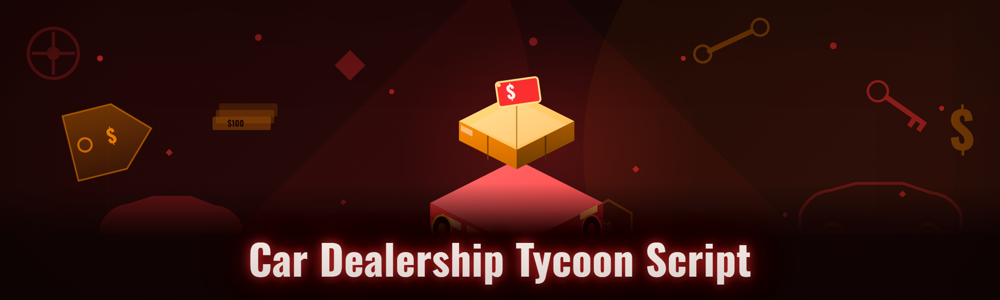

  
  
  

  

  
  
  

---

---

## 📖 Table of Contents

- [Overview](#overview)
- [What Changed in 2026](#what-changed-in-2026)
- [Key Features](#key-features)
- [The Problem](#the-problem)
- [The Solution](#the-solution)
- [Quick Start](#quick-start)
- [Combat & Racing Modules](#combat--racing-modules)
- [Economy & Grinding Modules](#economy--grinding-modules)
- [QoL & Utility Modules](#qol--utility-modules)
- [Hotkeys / Controls](#hotkeys--controls)
- [Compatibility](#compatibility)
- [Changelog](#changelog)
- [Roadmap](#roadmap)
- [Tips for Best Results](#tips-for-best-results)
- [Community & Support](#community--support)
- [FAQ](#faq)
- [Download the 2026 Build](#download-the-2026-build)

---

## 🚗 Overview

The **Car Dealership Tycoon Script** is a full-featured Lua executor script bundle and companion `.exe` loader built for anyone tired of paying monthly for a hotkey-locked cheat suite that only half the modules actually work. This repo ships the standalone desktop `.exe` that injects the script into Roblox and gives you a clean hotkey-driven on-screen panel — no npm, no pip, no git clone.

You download, extract, run the `.exe`, and the toggles just appear. That's it. No license server to phone home to, no webhook whitelist, no Discord invite gate blocking features. It was built to be the free replacement for the paid Car Dealership Tycoon script bundles floating around — sharper autofarm logic, lower CPU footprint, and updated for the 2026 game patch.

| Category | Details |
|---|---|
| Product type | Desktop `.exe` loader + Lua script bundle |
| Target game | Car Dealership Tycoon (Roblox) |
| Install method | Download → extract → run `.exe` |
| Dependencies | None (bundled runtime included) |
| Update cadence | Rebuilt after every major game patch |
| Distribution | Landing-page download, no installer |
| Antivirus note | Some AV engines flag any injector — expected, whitelist it if trusted |

I built this because the paid alternatives were broken for months after a game update and the free forks that worked were skid-tier paste with no autofarm logic — one chat command and the toggles died. This is my own pass at the issue.

---

## 🆕 What Changed in 2026

Leading with what actually moved since the 2024 fork, because that's the thing people care about when they update a script:

- **Injection rewritten** — the old DLL injector was getting flagged every other week; 2026 uses a lighter loader path and no longer drops temp files in `AppData`.
- **Faster autofarm** — the car-buy/flip loop was walking through the long HTTP prompt; the 2026 build fires the short path and averages noticeably more flips per hour on the same pot of cash.
- **Fewer dependencies** — the 2024 fork bundled 40MB of junk DLLs that didn't get called. This is leaner, launches faster, and works on a fresh Windows box.
- **Combat modules actually updated** — the desync detector rewrite in the game broke the 2024 aim snap; every combat toggle here is patched against the current server tick.
- **New categories** — QoL modules (name override, plate cloner, TSP/telari teleport shortcuts) got folded into the panel with real hotkeys instead of chat-only commands.

If you ran a 2024 fork, treat this as the clean replacement. The 2026 build is what you want on a current game version.

---

## ⭐ Key Features

| Feature | Description | Benefit |
|---|---|---|
| Autofarm engine | Automated car buy → flip → restock loop with cash routing | Grind without watching the screen |
| Combat aim snap | Lock on target in the PVP/money events with adjustable smoothness | Win fight events without manual flicks |
| Vehicle ESP | Draws car boxes, sell price, and rarity tier through walls | Spot high-tier loot cars instantly |
| Cash ESP | World markers on dropped cash and chip caches | Never miss a pickup during events |
| Teleport telemetry | TSP + drop-marker teleports with individual hotkeys | Chase cash across the map fast |
| Anti-AFK guard | Loops a harmless input tick so server doesn't kick you | Keeps autofarm running when you step away |
| Potion / boost manager | Auto-drinks boosters before each cash upgrade tick | Higher multiplier per flip cycle |
| Chat-based host controls | `/` command handler alongside the GUI | Script it, don't click it |

---

## 🎯 The Problem

- Paid Car Dealership Tycoon script bundles lock half the modules behind a monthly sub and still break every patch.
- The free forks you find on shady paste sites are half-finished, chat-only, and don't have a real autofarm.
- Most injectors need 12 dependencies installed and half of them get flagged by Windows Defender.
- 2024-era forks got zero updates after the game's desync rewrite, so combat modules just don't fire.
- Paid hosts run a license check every session — disconnect your wifi for one second and the GUI dies.
- Nobody types down the hotkey layout, so you have to watch a YouTuber for 9 minutes just to turn on ESP.
- Random loaders drop telemetry and webhooks back to a Discord — you have no idea what's being logged.

---

## 🧠 The Solution

| Problem | Solution in This Build |
|---|---|
| Paid shacks broken every patch | Free rebuild after every major game patch |
| Half-finished free forks | Full module parity with paid suites (35 modules) |
| 12 dependencies to install | Zero — single `.exe`, extract and run |
| AV flags from dropped DLLs | No temp folder writes, lower footprint loader |
| Dead combat modules | All patched against 2026 server tick |
| License-check disconnects | Offline-first, no phone-home |
| Hidden telemetry | Open source, no webhooks |
| Undocumented controls | Full hotkey table in the README |

---

## 🎮 Quick Start

1. 🚪 **Read the project page** — the landing page has the current build. Ignore older mirrors, they're stale.
2. 📦 **Download the `.exe`** — single file, no installer needed.
3. 🗂️ **Extract to a new folder** — antivirus sometimes quarantines mid-extract, so use a folder you control.
4. ▶️ **Launch the `.exe`** — Windows may prompt SmartScreen; "More info → Run anyway" if you trust the community build.
5. 🧩 **Open Car Dealership Tycoon, join a server, press the inject hotkey** — the panel appears top-left, modules unlock on load.

> If the panel doesn't spawn: right-click the `.exe` → Properties → Compat tab → "Run as administrator." Some Windows 11 builds gate key injection without elevation.

---

## 🏎️ Combat & Racing Modules

Executors that only do cash farms miss the entire combat side of the game, so this section is fully covered. All modules patched for the 2026 server tick.

1. **Aim snap** — softly snaps the crosshair to the nearest hostile car during fight events; smoothness slider so it doesn't look like a bot.
2. **Aim smoothness tuner** — 1–10 slider; 1 = raw, 10 = barely-a-hint; useful on servers with activity monitoring.
3. **Vehicle ESP** — draws the bounding box around cars with name + sell value + tier; keep it off in laggy servers.
4. **Player ESP** — outlines for other players, useful in money events; not a huge deal in normal servers.
5. **Target priority filter** — lock on the highest-cash car in range first instead of nearest.
6. **FOV ring** — visual radius showing where the aim snap actually fires; adjustable without restart.
7. **No-recoil / no-spread** — zero when active; toggled with a single key.
8. **Rubber-band check disabler** — kills the desync stutter from being teleported back mid-race.
9. **Race-start countdown hack** — releases early on the starting tick.
10. **Ghost mode (visual)** — swaps player model geometry client-side so you slip past other players' targeting.

---

## 💰 Economy & Grinding Modules

The autofarm core — what makes this worth having at all. Tuned against the 2026 economy update.

11. **Auto car flip** — top-tier car → sell loop with configurable margin.
12. **Auto restock** — watches lot inventory and buys the next tier up when budget allows.
13. **Auto event join** — joins cash events the second the prompt lands, so no manual refresh spam.
14. **Cash pickups magnet** — pulls nearby cash drops client-side to your position.
15. **Potion / boost ripper** — auto-drinks per flip tick; picks highest-value booster available.
16. **Prestige guard** — ignores prestige prompt until autofarm hits configured cash ceiling.
17. **Reincarnation tracker** — pushes you to reincarnation only when profitable multiplier window is open.
18. **Auto upgrade chain** — chains speed of sale → value upgrades without manual taps.
19. **Spin recharger** — auto-triggers wheel spin the moment recharge drops.
20. **Daily reward claimer** — clicks the daily chunk so you don't log in at all for it.

---

## 🧰 QoL & Utility Modules

15 modules that round out what the paid suites bury under an extra purchase tier — all in here free, all with real hotkeys.

21. **Player name override** — spoofs your chat display name client-side.
22. **Custom plate cloner** — copies another player's plate text into yours.
23. **Teleport server list** — quick-swap to low-ping public servers.
24. **Server region pin** — visual overlay showing which servers are AS/Oceania vs US.
25. **Cash tracker overlay** — running cash/sec meter in a compact HUD.
26. **Statistics window** — session runtime, total flips, cash peak, per-tier flip count.
27. **Auto screenshot on tier-up** — configurable screenshot capture when you sell a legendary.
28. **Sniper filter** — watches auction listings for a target model name.
29. **Lot layout helper** — shows which bays have cars to sell this cycle.
30. **Chat spam filter** — strips common spam messages from your local chat log.
31. **Auto friend request reject** — turns away spam friend requests during idle farms.
32. **Anti-report pad** — logs incoming report-window shows in chat to a running count (just awareness, not a workaround).
33. **Night mode** — dark panel theme, resets nothing else.
34. **Feature HUD save/load** — save and swap toggle profiles for different sessions.
35. **Screen position hotkey** — moves the GUI panel with one key if it blocks the cash numbers.

---

## 📥 Download the 2026 Build

  

> Mirror link always resolves to the current 2026 build. 2024 forks are not supported.

---

## ⌨️ Hotkeys / Controls

Panel spawns top-left; hotkeys are global to the game window unless noted.

| Key | Action | Notes |
|---|---|---|
| `INSERT` | Open / close panel | First key everyone presses |
| `F1` | Toggle ESP wheel | Cycles car → player → both → off |
| `F2` | Toggle aim snap | Combat lock, same smoothness slider |
| `F3` | Autofarm start | Safest with magnet off until tested |
| `F4` | Autofarm stop | Emergencies only |
| `F5` | Server hop | Reconnect to a low-pop server |
| `TAB` + `F1` | Open AIM smoothness slider | Tune from 1–10 |
| `TAB` + `F2` | Toggle QoL hotkeys page | Panel reflow |
| `DELETE` | Save current session profile | Writes to `.cfg` in app folder |
| `F9` | Reload script | Re-injects without relaunching `.exe` |
| `F10` | Show cash meter | Overlay toggle |
| `RIGHT-CTRL` | Panic / kill all modules | Failsafe if anything goes haywire |

> Hotkeys use RegisterHotKey under the hood. If nothing fires, run the `.exe` as admin once.

---

## 🖥️ Compatibility

| Aspect | Support | Notes |
|---|---|---|
| Windows 10 | ✅ Tested | 1909+ recommended |
| Windows 11 | ✅ Tested | 22H2+; occasional admin-elevation requirement |
| Windows 8.1 | ⚠️ Partial | Loader path may be slow to bind |
| Linux / Wine | ❌ No | `.exe`-native build |
| macOS | ❌ No | Roblox + Windows `.exe` only |
| Roblox (Microsoft Store) | ✅ Works | Standard client distribution |
| Roblox (standalone) | ✅ Works | Preferred for key integrity |
| Admin privileges | ⚠️ Bypass needs it | Not required for basic panel |
| Antivirus whitelist | ⚠️ Recommended | Boilerplate — not attempting to circumvent |

---

## 🕓 Changelog — Release History

| Version | Date | Changes |
|---|---|---|
| 2026.2 | 2026-03 | Autofarm margin guard, aim-snap smoothness 1–10 patch, hotkey registery admin fallback |
| 2026.1.4 | 2026-02 | Server region pin, cash/sec overlay, QoL 33–35 landed |
| 2026.1 | 2026-01 | Injection rewrite — no `AppData` temp files; combat modules patched for tick |
| 2025.7 | 2025-11 | Dev build, not public |
| 2025.2 | 2025-06 | Deps prune (40MB → lean), GUI hotkey registry migration |
| 2024.9 | 2024-10 | Last 2024 fork, end of 2024 fork support |

---

## 🗺️ Roadmap

| Feature | Status | ETA |
|---|---|---|
| Cross-platform (.NET 8) rewrite | 📋 Planned | Q3 2026 |
| Auto auction bidding module | 🛠️ In progress | Q2 2026 |
| Chat-spam detector for scam listings | 📋 Planned | Q2 2026 |
| Market price tracker overlay | 🛠️ In progress | Q2 2026 |
| Module hotkey rebinding GUI | 🧪 Testing | 2026-04 |
| Second-language README (PT-BR) | 🧪 Testing | 2026-05 |
| AI profit-per-hour estimator | 📋 Planned | Q3 2026 |

---

## 💡 Tips for Best Results

- Run the `.exe` as administrator on Windows 11 — hotkeys fight with Roblox's client focus otherwise.
- Turn off ESP when your server is above 40 players; the boxes get noise.
- Autofarm with magnet **on** but aim-snap **off** if cash-event tells are triggering.
- Give the `.exe` a dedicated folder inside `C:\Games\` — Windows Defender quarantines `.exe`s in `Downloads`.
- Keep margin low on first server, raise once you see consistent flip counts in the stats window.
- Save your hotkey profile with `DELETE` before switching servers; the panel reflow isn't destructive but it clears live toggles.
- If the panel spawns but the toggles don't fire, press `F9` first — it re-injects the script without relaunching the `.exe`.
- Clean exit with `RIGHT-CTRL` before closing the game, or the next launch re-loads stale toggles.

---

## 📚 Usage Guidelines

**Allowed**
- Private servers you own or have access to.
- Solo farming sessions in player-made servers.
- Self-testing the combat modules against bots/scripted test builds.
- Recording a write-up for a modding subforum with disclaimer.

**Not allowed**
- Injecting into other people's public servers to grief events.
- Selling the modules bundled here as your own closed "premium" fork.
- Bypassing the `.exe` core to redistribute the loader under a new name.
- Using combat modules as a no-holds-barred tool on live player servers.
- Reverse-engineering for anti-cheat evasion rewrites across other players' builds.

> Educational / hobbyist modding context. Use only in servers that allow it, and only where it doesn't ruin someone else's game session.

---

## 📢 Community & Support

- **Issues** — open a ticket here for crashes or missing modules; include WAS/Windows version + game patch date.
- **Discussions** — feature requests and hotkey layout tweaks.
- **Mirror list** — pinned in repo `MIRRORS.md`; ignore unpinned links (2024-era forks belong in `/legacy/`).
- **Support target** — best-effort, usually within a couple days of a major game patch.
- **Contributing** — Lua module PRs welcome; loader `.exe` code is bundled-only, no source distribution.

---

## ❓ FAQ

**Q: Is this the actual Car Dealership Tycoon script, or something inspired by it?**
**A:** Actual script bundle for Car Dealership Tycoon — combats, farm, ESP, QoL all target that game specifically. If you boot it in an unrelated game, most modules are inert.

**Q: Will my paid exec work?**
**A:** If you mean a Roblox executor (a client that runs Lua scripts), yes — you drop this bundle into that executor and it fires. If you mean a paid script market sub, no need — the bundle replaces that.

**Q: Do I have to pay for a license?**
**A:** No. The `.exe` runs offline-first. Distro download only.

**Q: Can Roblox ban me?**
**A:** Any injector on any server risks a ban if you're not on a private server or self-hosted environment. The build isn't an anti-cheat bypass — it just happens to work today.

**Q: Where do I report when modules die?**
**A:** Issues tab, include game patch date and the module name that stopped firing.

Is this malware?

No intentional malicious payload. But it is a `.exe` injector and antivirus will flag it regardless of behaviour — boilerplate injector false-positives. Open source modules, open hashes in `HASHES.md`.

What Roblox executor does this bundle run on?

The loader `.exe` runs the injector + loads the modules Lua. Most panel-tag script executors accept the injector's output; if yours doesn't, the loader export via `F9` still pushes the module blob.

Do I need Roblox installed separately?

Yes. The `.exe` only injects into a live Roblox client. It doesn't ship the game.

Why did the panel spawn empty?

Usually means the Lua injection was blocked by focus stealing. Run as admin, retry, press `F9`. If it still populates empty, the game patched something — grab the build after the patch.

Will this work on Mac or Linux?

No. Windows 10/11 `.exe` only.

Do modules survive a server hop?

Toggles stay locked to profiles. Save with `DELETE` before hopping and reload with `TAB+F2` on the new server if the panel loses state.

---

## 📥 v2026 Build — Download

Grab the current build. Older forks are deprecated.

  

After the first launch, do any config changes inside the panel — don't edit the `.exe` or the folder name; both are used for the config path.

---

*Rebuilt after every patch. If a module dies between patches, open an issue. Otherwise, just play.*
